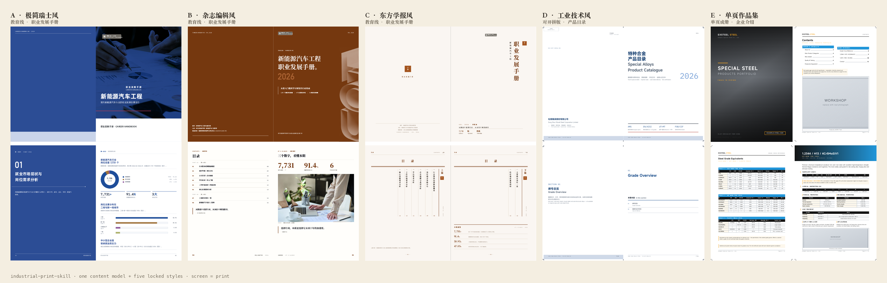

# industrial-print-skill

<p align="center">
  一套<strong>版式锁死</strong>的图文混排印刷品生成系统：<strong>一套内容模型（JSON）+ 五套视觉风格</strong>，
  以 Claude Code / opencode / WorkBuddy 等 Agent Skills 形式交付。
</p>

生成**可打印分页的单文件 HTML**：屏幕纵向滚动一屏一卡，`@media print` 逐页输出，
浏览器「打印 → 另存为 PDF」得成品，再跑一道后处理补上 TrimBox/BleedBox 与裁切标记即可送印。
两种页面单位：**E 单页成册**（210×297，一页一个主题）与 **D 对开拼版**（420×297，跨页大图）。
换内容只换「内容 JSON + 主题色」，换风格只换发起词——物理规格、骨架、图表纪律全部不变。

<p align="center">
  
</p>

## 四条线怎么选

| 线 | 模版 | 做什么 | 页面单位 |
|---|---|---|---|
| **E · 单页作品集风** | `templates/E-portfolio/` | 企业介绍 / 作品集 / 牌号手册（一页一个牌号）；含封底与跨对开页型 | 单页 210×297，216×303 含出血 |
| **D · 工业技术风** | `templates/D-industrial/` | 产品目录 Catalog / 技术数据 Technical Data（对开拼版、跨页大图） | 对开 420×297，426×303 含出血 |
| **A · 极简瑞士风** | `templates/A-career/` | 职业发展 / 就业指导 / 人才培养方案 / 新生手册 | 210×285 大 16 开 |
| **B · 杂志编辑风**（教育线默认） | `templates/B-editorial/` | 同上，图文混排、文章式 | 同上 |
| **C · 东方学报风** | `templates/C-journal/` | 同上，宣纸墨色、竖排目录、印章 | 同上 |

**E 与 D 怎么选**：先问「一个牌号 / 一个主题值不值一整页」。值 → E；不值、需要两三个挤在一对开 → D。
D 适合整本按对开读的长文，E 适合条目多而每条不长的册子——E 需要一两张跨页大图时用 `spread` 页型即可，不必换 D。选错页面单位是「版面空」的第一原因，
不是字号也不是配色。完整路由见 `SKILL.md`。

## 能力

- **印刷级物理规格**：E 线成品 210×297、印刷幅面 216×303（四缘 3mm 出血）；D 线对开 420×297、幅面 426×303（订口不出血），可切 `cn16`；教育线 210×285 / 432×291
- **送印 PDF 后处理**：`_shared/pdf_print_marks.py` 补 TrimBox / BleedBox / 四角裁切标记 / 折线标记——浏览器另存的 PDF 没有这些，印厂无处对刀
- **真单文件交付**：E/D 线 `build --single`（字体子集化 + base64 内嵌，E 约 2~3MB、D 约 1~2MB）；教育线用 `_shared/inline-fonts.mjs` 后处理同一效果
- **官网图片抓取**：`scripts/fetch-images.mjs` 同域 + robots 合规抓图，自动量出「300ppi 下最大可印宽度」，写 `manifest.json` 与 `sources.md` 来源清单
- **中英双语**：D 线 `meta.lang` 支持 `zh` / `en` / `bi`，两语同写、CSS 按 `data-lang` 切换，切语言不动版式
- **14 套主题色板**：hex + CMYK 双值，构建时自动注入，只许选不许自定义
- **可商用字体**：MiSans / Alibaba PuHuiTi 3 / IBM Plex Mono / Noto Serif SC，打印自动内嵌
- **构建 + 校验双脚本**：build 出稿、validate 把关，0 错误才算过；checklist P0 自检
- **8px 基线网格**：图表长度由数据计算（`--v/--max`），一页一对开一个主体，版式不漂移

## 30 秒开始

```bash
# 1. 安装（克隆到你的 skills 目录，这里以 WorkBuddy 个人级为例）
git clone https://github.com/Guyzn/industrial-print-skill.git ~/.workbuddy/skills/industrial-print-skill

# 2. 然后直接对你的 AI 助手说：
# 「帮我们做一本产品目录，要送印刷厂的，中英双语」
```

不装也可以先看效果：`docs/preview-5styles.png`，或各模版 `prototype/` 下的原型 HTML。

## 使用流程（D 线，开发者）

```bash
# 1. 写内容 JSON（E 参考 templates/E-portfolio/content/example-portfolio.json；
#                  D 参考 templates/D-industrial/content/example-catalog.json）
# 2. 构建（加 --single 得真单文件：字体子集化 + 图片 base64）
node templates/E-portfolio/scripts/build.mjs \
  templates/E-portfolio/content/example-portfolio.json \
  ./企业介绍.html --single
# 3. 校验 —— 0 错误才算过，不过不允许进下一步
node templates/E-portfolio/scripts/validate.mjs ./企业介绍.html
# 4. 浏览器打开 → 打印 → 另存为 PDF（Chrome/Edge 关页眉页脚）
# 5. 补裁切规格：浏览器不写 TrimBox/BleedBox，印厂无处对刀
python3 _shared/pdf_print_marks.py 产品目录.pdf -o 产品目录-送印.pdf
# 6. 字体嵌入自证：PDF 里只许见 MiSans/IBMPlexMono 等；
#    见 NSimSun/YaHei/Arial/Menlo/PingFangSC 即回退，打回重做
pdffonts 产品目录-送印.pdf
```

口径：E 单页成品 210×297mm、印刷幅面 216×303mm；D 对开成品 420×297mm、印刷幅面 426×303mm。
`--single` 依赖 fontTools（`pip install fonttools brotli`），`pdf_print_marks.py` 依赖 pypdf。

教育线（A/B/C）流程相同，但没有 `--single` 参数——构建后跑一次
`node _shared/inline-fonts.mjs <产物.html>` 得到同等效果的单文件。

完整工作流（澄清 → 选主题 → 写 JSON → 构建 → 校验 → checklist 自检 → 打印核对 → 补裁切规格）
见 `templates/D-industrial/README.md` 与 `references/checklist.md`；技术数据表先读
`templates/D-industrial/references/grade-datasheet.md`（牌号数据骨架 + basis/cond 标注规则）。

## 核心设计原则（不可妥协）

1. **单主题单 accent** — 一份印刷品只用一套主题色，accent 小面积点缀，禁止大面积铺色
2. **直角纯色** — 不允许渐变 / 阴影 / 圆角（hairline 分割线除外）
3. **网格至上** — 8px 基线网格；「留白」与「故意错位」都是建立在对齐自知之上的有意选择
4. **数据由数据计算** — 图表长度全部由 `--v/--max` 计算，每个数据点有类别 + 数值标签
5. **一页（一对开）一个主体** — 溢出先删内容/拆页，不压字号硬塞
6. **印刷先于屏幕** — 出血 3mm、安全区、字体本地化嵌入为 P0；送印 PDF 必须补 TrimBox/BleedBox + 裁切标记
7. **价格禁编造** — 目录/报价类内容中的价格必须经内部核价后填入，示例 JSON 只放公开标准口径
8. **字体嵌入要自证** — PDF 里出现系统字体即失败；`@font-face` 写进 `:root{}` 会被浏览器整体丢弃，属静默故障

## 适合 / 不适合

| 适合 ✔ | 不适合 ✘ |
|---|---|
| 产品目录 / 技术数据表 / 企业介绍 / 宣传册 | 需要 Word / PPT / 在线编辑格式的文档 |
| 送印刷厂的实体手册 | 需要交互、视频等电子阅读体验的内容 |
| 图表与图文混排密集的印刷品 | 需要自定义任意版式的「自由排版」需求 |
| 中英双语外贸文档 | 单页非对开、无出血规格的轻量文档 |
| 职业发展 / 就业指导 / 新生手册（教育线） | |

🔴 **STOP · 送印前强制人审**：`validate` 0 错误只是机械合格。送印前必须逐条过 checklist 的 P0 清单
并人工核对样张——占位 logo/插图是否已换、价格是否已核价、PDF 字体嵌入自证是否干净，三项任何一项存疑即停。

## 示例请求（可直接复制）

```
帮我们做一本产品目录，要送印刷厂的，中英双语
```

```
我要一份 H13 模具钢的技术数据表，客户是德国的
```

```
把这份内容 JSON 换成深松绿主题重新出稿
```

```
帮我做一本「新能源汽车工程」专业的职业发展手册，极简瑞士风，主题色 eco-pine，20 页左右。
```

## 安装

**方式一：git clone（推荐）**

```bash
# 个人级（所有项目可用）
git clone https://github.com/Guyzn/industrial-print-skill.git ~/.workbuddy/skills/industrial-print-skill

# Claude Code
git clone https://github.com/Guyzn/industrial-print-skill.git ~/.claude/skills/industrial-print-skill

# 项目级（仅当前项目，团队共享）
git clone https://github.com/Guyzn/industrial-print-skill.git ./.workbuddy/skills/industrial-print-skill
```

**方式二：把这段话发给你的 AI**

> 帮我安装 industrial-print-skill。请把 https://github.com/Guyzn/industrial-print-skill
> 克隆到 ~/.workbuddy/skills/industrial-print-skill，安装完成后检查 SKILL.md 和 templates/ 目录是否完整。

## 目录结构

```
industrial-print-skill/
├── SKILL.md                 ← 风格路由 + 通用纪律（Skill 入口）
├── PLAN.md                  ← 教育线（A/B/C）实施计划，历史存档
├── test-prompts.json        ← 路由验收用例
├── _shared/                 ← 各模版共用，勿复制
│   ├── fonts/               ← 可商用字体（见 fonts/README.md 版权声明）
│   ├── placeholders/        ← 中性占位 logo
│   ├── themes.md            ← 14 套主题色板（hex + CMYK）
│   ├── image-sourcing.md    ← 图片来源与授权规则（同域 / robots / 300ppi / 登记）
│   ├── inline-fonts.mjs     ← 字体内嵌器：目录产物 → 真单文件（子集化 + base64）
│   └── pdf_print_marks.py   ← PDF 后处理：TrimBox/BleedBox + 裁切标记
├── scripts/
│   └── fetch-images.mjs     ← 官网抓图：同域 + robots + 尺寸判定 + 来源清单
└── templates/
    ├── E-portfolio/         ← 单页作品集风：企业介绍 / 作品集 / 牌号手册
    ├── D-industrial/        ← 工业技术风：Catalog / Technical Data（对开）
    ├── A-career/            ← 教育线：极简瑞士风
    ├── B-editorial/         ← 教育线：杂志编辑风（默认）
    └── C-journal/           ← 教育线：东方学报风
```

每个模版目录**自包含**：`assets/`（单文件种子 + 版式系统）、`references/`（layouts 骨架库 + checklist）、
`scripts/`（build + validate）、`content/`（示例 JSON）。

## 主题色预设

| 主题 | 定位 | 线 |
|---|---|---|
| academy-blue / engineering-terra / eco-pine / academic-teal | 教育 · 理工 · 生态 · 学术 | A / B 通用 |
| swiss-ochre / burgundy / slate-blue / deep-aubergine | 瑞士 · 酒红 · 藏蓝 · 深紫 | A / B 通用 |
| cinnabar（朱砂） | 宣纸底 + 墨 + 朱砂唯一点缀 | C 专属 |
| **steel-blue（钢蓝）** | 特种钢/合金产品目录、通用工业（D 默认） | D |
| **graphite（石墨）** | 技术数据表、检验规范、白皮书 | D |
| **oxide-red（氧化红）** | 热作模具钢、热处理、锻件 | D |
| **deep-pine（深松绿）** | 不锈钢深加工、绿色制造、长效件 | D |
| **shenda-amber（申达橙金）** | 申达品牌物料：橙金 + 冷蓝双色，印刷须打样或走专色 | E / D |

主题色一律从 `_shared/themes.md` 选，**只许选不许自定义 hex**；构建脚本自动注入 token。

## 字体版权声明

内置字体均为可商用字型：MiSans、Alibaba PuHuiTi 3、IBM Plex Mono、Noto Serif SC。
来源与许可明细见 **[`_shared/fonts/README.md`](_shared/fonts/README.md)**——随仓库发布请保留该文件。

## 镜像分享说明

本仓库可安全公开分享（镜像 / 同行评审 / 教学演示）：

- 所有模版内置的是**中性占位 logo**（`_shared/placeholders/` 与各模版 `content/images/`）与**仅作版式演示的示例内容**。
- 示例 JSON 中的公司名、联系人、邮箱、网址、电话、地址均为**虚构占位**，不含任何真实经营信息。
- **正式交付或送印前必须替换**：① 占位 logo → 真实标识；② 示例内容 → 真实产品数据与图片（全出血 ≥ 300dpi，插图 ≥ 200dpi）；③ 价格字段经内部核价后填入。
- 各模版 `README.md` Step 4 与 `references/checklist.md` 的 P0 项均包含该替换检查。

## 参考作品

- 示例特钢 · 企业介绍 / 作品集（E 线，11 页单页成册，牌号一页一版）
- 示例特钢 · 产品目录 / 企业介绍 / 技术数据表（D 线三例，各 10~15 对开）
- 新能源汽车工程 · 职业发展手册（教育线三例，各 20–22 页）
- 风格参考：Josef Müller-Brockmann 网格系统 / The New York Times Magazine 栏目系统 / 中华书局古籍版式

## FAQ

**能做 Word / PPT 吗？**
不能。本 skill 只产出可打印 HTML 与「另存为 PDF」的对开印刷成品，这是印刷级规格的前提。

**D 线和教育线的 JSON 能互转吗？**
不能。两套内容模型的字段不同（D 有 `grades`/`twin`/`flow`/`stats` 等工业块，教育线是 `chapters` 结构），
按目标模版的 example 重建，不要硬改。教育线三套（A/B/C）之间同样不能直接互转。

**做完了想换风格怎么办？**
换模版重跑 build，内容 JSON 按目标模版结构改写；主题色只换 `meta.theme` 一个字段。

**能从我们官网扒图用吗？**
能，但有两条硬线。`node scripts/fetch-images.mjs https://你们的域名` 会按同域 + robots 规则抓，
并算出每张图在 300ppi 下的最大可印宽度——官网图多数是 569~1200px 的网页图，只够印 48~100mm，
放整幅必虚，得找原图或重拍。另一条是授权：官网图不等于可自由使用，`sources.md` 的授权列留空就不许送印。
完整规则见 `_shared/image-sourcing.md`。

**字体商用安全吗？**
安全。全部内置可商用字体，来源与许可明细见 `_shared/fonts/README.md`。

**微信直接发 HTML 给客户行不行？**
目录版不行——字体是外挂的，对方打开会掉字体、版面全崩。发 `--single` 单文件（1~2MB）或直接发送印 PDF。

**没有 fontTools 怎么办？**
`--single` 退化为全量内嵌（约 95MB，功能不受影响）。装上 `fonttools brotli` 即恢复子集化。

**支持哪些 AI 环境？**
支持 Agent Skills 机制的环境：Claude Code、opencode、WorkBuddy 等。

## License

[MIT](LICENSE)
